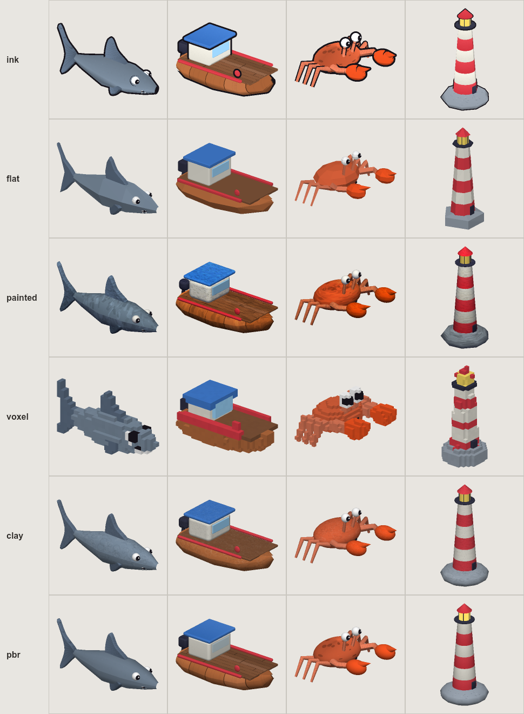

# stylemesh

**Code-first 3D assets for AI agents.** Write a model once as a short JavaScript function, then export it as a game-ready GLB in any art style.



Built for agents first:

- **Agents can see.** `stylemesh render` draws a PNG contact sheet (side, front, top and iso views) on the CPU. It needs no GPU, browser or display, so an agent can look at what it made.
- **JSON everywhere.** Every command takes `--json` and prints one `{ok, ...}` object. Errors carry a `code` and a `hint` saying what to try next.
- **MCP server built in.** `stylemesh mcp` exposes list, inspect, render (returns the image), check, build and new as tools.
- **Guardrails.** `stylemesh check` catches NaN geometry, missing UVs, degenerate triangles, blown tri budgets, wrong scale and unused materials.
- **One guide.** [AGENTS.md](AGENTS.md) is the full authoring reference: conventions, shapes, painters, styles and the edit, render, check loop.

## Styles

| Style | Look | Surface |
|---|---|---|
| `ink` | Bold ink outlines, soft toon shading | painted textures + inverted-hull outline |
| `flat` | Low-poly, faceted | solid colours + per-face jitter |
| `painted` | Hand-painted MMO look | brush-stroke textures + baked top light / AO |
| `voxel` | Block-game cubes | surface-voxelized, per-voxel jitter |
| `clay` | Matte plasticine | solid colour + fingerprint grain |
| `pbr` | Physically based, for lit engines | base colour + generated normal + ORM maps, emissive, blended glass |
| `roblox` | `ink` for Roblox | untinted (the game tints at runtime), eyes merged into one `Face` mesh |

## Quick start

```bash
git clone https://github.com/MrsHorrid/stylemesh && cd stylemesh
npm install                                   # Node >= 20
node cli.js list                              # 30 example assets
node cli.js render Prop_Boat --style painted  # -> Prop_Boat_painted.png
node cli.js build --style all                 # -> out/<style>/*.glb
node cli.js view                              # http://localhost:5177
```

Make your own:

```bash
node cli.js new Prop_Lantern --file assets/lantern.js
node cli.js render Prop_Lantern --assets assets/lantern.js
```

## Use with an agent

**Claude Code**: inside this repo, `.mcp.json` registers the server and `CLAUDE.md` points at `AGENTS.md`. From anywhere else:

```bash
claude mcp add stylemesh -- node /path/to/stylemesh/cli.js mcp
```

**Other MCP clients**: run `node /path/to/stylemesh/cli.js mcp` as a stdio server.

**No MCP**: any agent that can run shell commands can use the CLI with `--json`.

MCP tools: `guide`, `list_assets`, `list_styles`, `inspect_asset`, `render_asset`, `check_assets`, `build_assets`, `new_asset`.

## An asset

```js
import { Asset } from 'stylemesh/core';
import { body, sphere, smoothFin } from 'stylemesh/shapes';
import { fishBody, finRays } from 'stylemesh/paint';

export function myFish() {
  const a = new Asset('Fish_Mine', { outline: 0.022, meta: { kind: 'fish' } });
  a.material('Body', { paint: fishBody('scales'), tint: '#ff9f43' });
  a.material('Fin', { paint: finRays(), tint: '#ffd166' });
  a.add('Body', body([[-0.5, 0.03, 0.05, 0], [0, 0.2, 0.3, 0], [0.5, 0.05, 0.07, 0]]));
  a.add('Fin', smoothFin([[-0.45, 0], [-0.8, 0.3], [-0.7, 0], [-0.8, -0.3]], 0.04));
  return a;
}
export default [myFish];
```

The style is applied when the asset is built. Segment counts, bevels, outlines, textures and lighting all adapt, so the same function gives you every style.

## Known limits

- `solid`, `voxel` and `clay` average each material to one colour, so stripes flatten.
- Vertex colours (`painted`, `flat` jitter) work in three.js, Godot, Unity and Unreal. Roblox ignores them.
- `pbr` builds slowest (about 10s for 30 assets): it makes 3 textures per material in plain JS. Normal maps ship without tangents; engines generate them.
- The `render` preview uses fixed lighting. It shows shape, colour and outline, not final engine shading.
- There is no GUI modeler: assets are code. That is the point.

## License

MIT. The example assets in `examples/reelraiders/` come from the Roblox game Reel Raiders and are under the same license.
